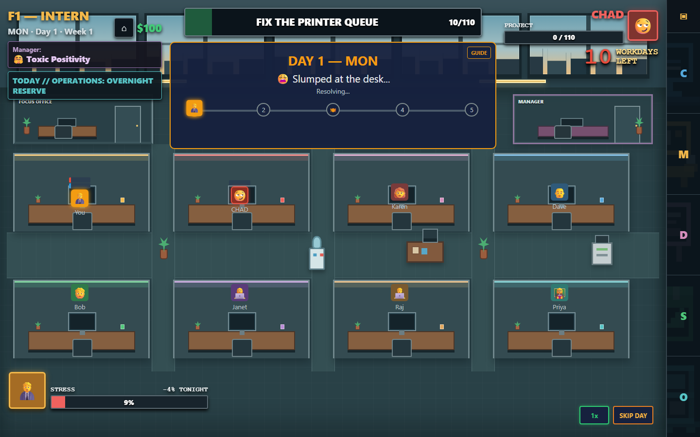

<div align="center">

# OfficeWars

**Do the work. Dodge the drama. Survive the org chart.**

A single-file office autobattler about climbing seven corporate floors before
Stress, the fixed workweek, or Chad ends the run.

This repository is distributed under the play-only terms in `LICENSE`.

[**Play OfficeWars**](https://mewzicians.github.io/OfficeWars/officewarsautobattler.html)
· [Project status](docs/PROJECT_STATUS.md)
· [Contributing](CONTRIBUTING.md)
· [Playtest guide](docs/PLAYTEST_GUIDE.md)


</div>



> **Current status:** Workday and Office Politics Phases 1-5, Home Phase 1,
> and the Guided Intern first-play tutorial are implemented. Seven Homes, 28
> available items, nine sets, the Home planner, and Active Buffs are live.
> Cash Jar and Galactic code is present but gated off.

## Play

No installation, server, account, or build step is required.

1. Open `officewarsautobattler.html` locally or play through GitHub Pages.
2. Choose a task and its fixed manager response.
3. Watch at 1x/2x/4x or use hidden Skip.
4. Resolve political decisions, manage Night, and climb toward the CEO.
5. On a phone, rotate to landscape.

## The Workday

| Phase | Player decision |
|---|---|
| Morning | Choose a primary task and fixed Comply, Resist, or Negotiate package |
| Workday | Watch cinematic actions and commit irreversible political choices |
| Skip / Reload | Continue through unanswered events without revealing future state |
| Clock Out | Review manager, project, coworker, Chad, boss, and economy results |
| Night | Use Home, Outings, Deals, recovery, and office politics |
| Weekend | Resolve mystery or Casino events before Promotion Review |
| Promotion | Claim Skill paths and build the next floor |

The implemented game includes fifty ordinary task cards, fixed rarities,
dynamic six-person floor rosters, Relationship and standing, managers,
Project Briefs, Boss Schemes, Alumni, Favors, Closing, Brand Strategy, and
versioned deterministic saves. Night also includes the seven-level Home
ladder, three-offer shop, item inventory and sets, deposits, sales, and
Prepare Tomorrow.

## Project Status

The implemented candidate is:

- SHA-256:
  `816A35B40CD4F36C6CF25CD766BF6FEB94A1D77D885C56947B73F6C4228F52AA`
- size: `1,730,955` bytes
- active-run schema: `9`

Cash Jar and Galactic activation, 1,000-paired-seed Home tuning, formal
screen-reader execution, and human evidence remain Not Run. Read
[Project Status](docs/PROJECT_STATUS.md) before changing balance or status.

## Project Map

| Path | Purpose |
|---|---|
| `officewarsautobattler.html` | Implemented game and runtime truth |
| `docs/GAME_DESIGN.md` | Stable gameplay model |
| `docs/BALANCE_LEDGER.md` | Exact values and decision status |
| `docs/HANDOFF.md` | Current implementation handoff |
| `docs/PROJECT_STATUS.md` | Candidate and evidence boundary |
| `docs/WORKING_WITH_AGENTS.md` | Human/agent collaboration method |
| `docs/ARCHIVE_SUPERSEDED.md` | Inactive history index |
| `verification/` | Dated evidence and active checklist |
| `AGENTS.md` | Repository instructions |
| `AUTOMATION_POLICY.md` | Visible automation and chud convention |

Historical ideas are not active requirements. Dated reports remain evidence
for the exact snapshot they name.

## Contributing

Read [CONTRIBUTING.md](CONTRIBUTING.md). Separate implementation facts, Locked
design, Draft tuning, Open questions, and Recovery Required content.

AI-assisted work must follow
[Working With Agents](docs/WORKING_WITH_AGENTS.md), verify implementation
claims against the HTML, and obey [Automation Policy](AUTOMATION_POLICY.md).

## Optional Verification

```powershell
python -m pip install -r requirements-dev.txt
python -m playwright install chromium
python .officewars-smoke-run.py
python .officewars-persistence-verify.py
python .officewars-phase1-verify.py
python .officewars-phase2-verify.py
python .officewars-phase3-verify.py
python .officewars-phase4-verify.py
python .officewars-phase5-verify.py
python .officewars-home-phase1-verify.py
python .officewars-home-schedule-verify.py
python .officewars-night-planner-verify.py
python .officewars-advanced-verify.py
python .officewars-full-verify.py 0
```

The game itself has no Python dependency.
