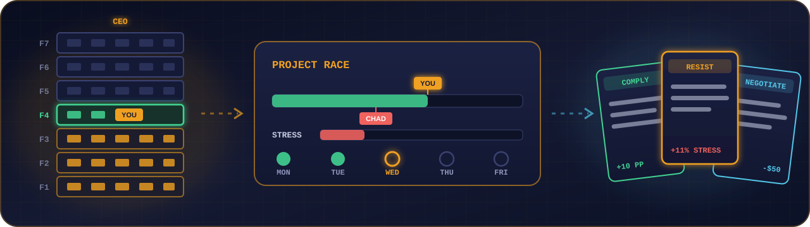
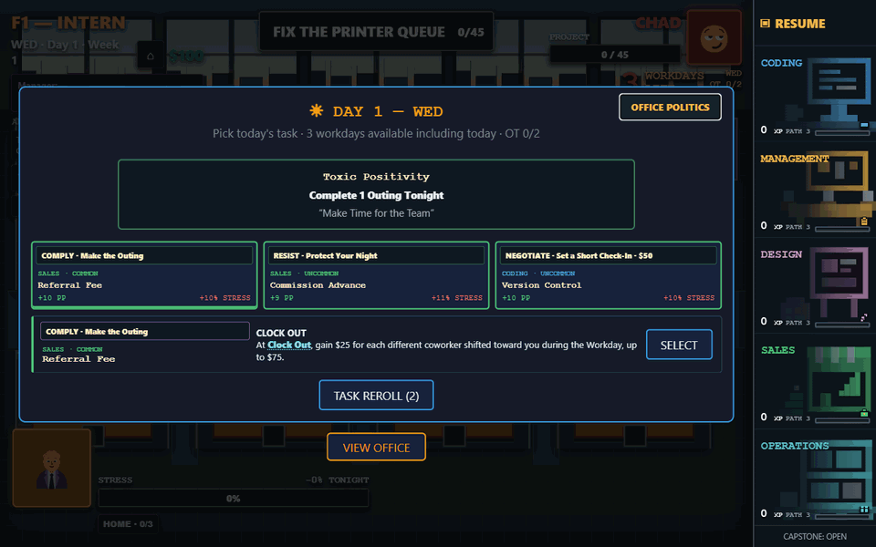
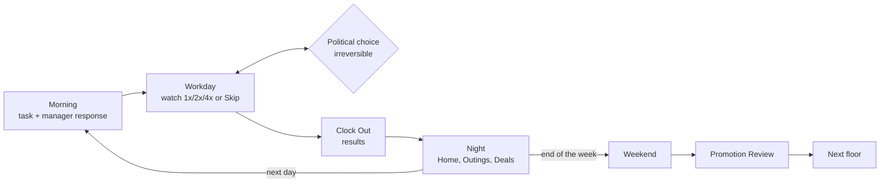

<p align="center"></p>

<div align="center">

# OfficeWars

**Do the work. Dodge the drama. Survive the org chart.**

A single-file office autobattler about climbing seven corporate floors before
Stress, the fixed workweek, or Chad ends the run.

<p>
  <a href="https://mewzicians.github.io/OfficeWars/officewarsautobattler.html"></a>
  <a href="#how-its-built"></a>
  <a href="docs/GAME_DESIGN.md"></a>
  <a href="#verification"></a>
  <a href="docs/PROJECT_STATUS.md"></a>
</p>

[**Play OfficeWars**](https://mewzicians.github.io/OfficeWars/officewarsautobattler.html)
· [Project status](docs/PROJECT_STATUS.md)
· [Contributing](CONTRIBUTING.md)
· [Playtest guide](docs/PLAYTEST_GUIDE.md)


This repository is distributed under the play-only terms in `LICENSE`.

</div>

<p align="center"></p>

> **Current status:** Workday and Office Politics Phases 1-5, Home Phase 1,
> and the Guided Intern first-play tutorial are implemented. Seven Homes, 28
> available items, nine sets, the Home planner, and Active Buffs are live.
> Cash Jar and Galactic code is present but gated off.

## Play

No installation, server, account, or build step is required.

1. Open `officewarsautobattler.html` locally or play through GitHub Pages.
2. Choose a task and its fixed manager response.
3. Watch at 1x/2x/4x or use hidden Skip.
4. Resolve political decisions, manage Night, and climb toward the CEO.
5. On a phone, rotate to landscape.

## The Workday

<div align="center">



</div>

| Phase | Player decision |
|---|---|
| Morning | Choose a primary task and fixed Comply, Resist, or Negotiate package |
| Workday | Watch cinematic actions and commit irreversible political choices |
| Skip / Reload | Continue through unanswered events without revealing future state |
| Clock Out | Review manager, project, coworker, Chad, boss, and economy results |
| Night | Use Home, Outings, Deals, recovery, and office politics |
| Weekend | Resolve mystery or Casino events before Promotion Review |
| Promotion | Claim Skill paths and build the next floor |


The implemented game includes fifty ordinary task cards, fixed rarities,
dynamic six-person floor rosters, Relationship and standing, managers,
Project Briefs, Boss Schemes, Alumni, Favors, Closing, Brand Strategy, and
versioned deterministic saves. Night also includes the seven-level Home
ladder, three-offer shop, item inventory and sets, deposits, sales, and
Prepare Tomorrow.

## How it's built

I design OfficeWars and build it with AI coding agents. This section covers
the process that keeps a large single-file game coherent while agents change
it.

### Design pillars

- **Office-friendly.** No timers or reflex input. The Workday plays itself and
  pauses only at authored political choices.
- **Deterministic.** Watching at 1x/2x/4x, Skip, reload, and headless
  simulation must produce the same run from the same seed.
- **Readable.** Rules live on cards, forecasts, tooltips, and Help. Supported
  screens never show scrollbars, so content must fit, reflow, or paginate.
- **One file.** The whole game is one standalone HTML file with no build step
  or server.
- **Balanced for skill.** The target is about 25-35 percent wins for a skilled
  player.

### Every decision has a state

Each value and rule in the [balance ledger](docs/BALANCE_LEDGER.md) is
Implemented, Locked, Draft, Open, Recovery Required, or Superseded. Agents may
propose values, but only an explicit approval locks one: silence, topic changes,
and recommendations never count. Superseded ideas move to the
[archive](docs/ARCHIVE_SUPERSEDED.md) with their reasoning, so they don't come
back from memory.

### Working with agents

- **One source hierarchy.** The HTML is runtime truth, then the
  [design](docs/GAME_DESIGN.md), the ledger, status, and dated evidence. Agents
  report a mismatch instead of resolving it silently
  ([Working With Agents](docs/WORKING_WITH_AGENTS.md)).
- **Nine [project skills](.agents/skills/)** cover planning, implementation,
  debugging, balance simulation, UX audits, playtest analysis, QA cleanup, full
  verification, and packaging.
- **A two-key rule** for lifecycle changes: the exact artifact and the exact
  verb (approve, reject, move...) must both come from a person.
- **Graded objections.** Agents label concerns Critical, Watchpoint, or Taste,
  so severity is clear before a design locks.
- **Visible conventions.** The [automation policy](AUTOMATION_POLICY.md)
  documents how delegated agents are addressed and reported, in the open.

### Music

The soundtrack is exploratory and not in the game yet. It follows a documented
[collaborative method](docs/MUSIC_GUIDE.md): listen before explaining, find the
earliest broken musical decision, and test the smallest audible change. Every
unfinished track keeps a protected Approved baseline and one Test branch, and
every audition has a label and status in the
[music catalog](docs/music/officewars/MUSIC_CATALOG.md).

### Verification

- **Checks in this repository:** 19 verification scripts (browser checks and
  simulations) and 122 [verification records](verification/). Each dated report
  names the exact game hash it tested.
- **Latest recorded results** ([Project Status](docs/PROJECT_STATUS.md) names
  the build each one tested):

  | Check | Result |
  |---|---|
  | No-scrollbar matrix, every player-facing screen | 354/354 |
  | Guided reachability, six viewports and 200% text | 364/364 |
  | Guided Intern journey, replay, reload, and accessibility | 47/47 |
  | General simulator | 750/750 runs, zero phase errors |
  | Formal screen-reader pass, broad human playtest | Not Run |

- **Balance isn't tuned yet, and the evidence says so.** In 1,000 seeded runs,
  the skilled simulation policy won none: 640 lost the project race to Chad, 343
  burned out, and 17 were fired. Simulated policies are instruments, not
  players, so tuning needs human playtests as well.
- **Honest reporting.** Every result is Pass, Fail, Not Run, or Blocked. A check
  that didn't run is listed, never counted as a pass.

## Project Status

The implemented candidate is:

- SHA-256:
  `1DA11A1FEC21B8AED383B1BDD53F2AAB0DAB55ADA8E2F1B188F26407DEFEC149`
- size: `1,731,492` bytes
- active-run schema: `9`

Cash Jar and Galactic activation, 1,000-paired-seed Home tuning, formal
screen-reader execution, and human evidence remain Not Run. Read
[Project Status](docs/PROJECT_STATUS.md) before changing balance or status.

## Project Map

| Path | Purpose |
|---|---|
| `officewarsautobattler.html` | Implemented game and runtime truth |
| `docs/GAME_DESIGN.md` | Stable gameplay model |
| `docs/BALANCE_LEDGER.md` | Exact values and decision status |
| `docs/HANDOFF.md` | Current implementation handoff |
| `docs/PROJECT_STATUS.md` | Candidate and evidence boundary |
| `docs/WORKING_WITH_AGENTS.md` | Human/agent collaboration method |
| `docs/MUSIC_GUIDE.md` | Collaborative music method |
| `docs/ARCHIVE_SUPERSEDED.md` | Inactive history index |
| `verification/` | Dated evidence and active checklist |
| `AGENTS.md` | Repository instructions |
| `AUTOMATION_POLICY.md` | Visible automation and chud convention |

Historical ideas are not active requirements. Dated reports remain evidence
for the exact snapshot they name.

## Contributing

Read [CONTRIBUTING.md](CONTRIBUTING.md). Separate implementation facts, Locked
design, Draft tuning, Open questions, and Recovery Required content.

AI-assisted work must follow
[Working With Agents](docs/WORKING_WITH_AGENTS.md), verify implementation
claims against the HTML, and obey [Automation Policy](AUTOMATION_POLICY.md).

## Optional Verification

```powershell
python -m pip install -r requirements-dev.txt
python -m playwright install chromium
python .officewars-smoke-run.py
python .officewars-persistence-verify.py
python .officewars-phase1-verify.py
python .officewars-phase2-verify.py
python .officewars-phase3-verify.py
python .officewars-phase4-verify.py
python .officewars-phase5-verify.py
python .officewars-home-phase1-verify.py
python .officewars-home-schedule-verify.py
python .officewars-night-planner-verify.py
python .officewars-advanced-verify.py
python .officewars-full-verify.py 0
```

The game itself has no Python dependency.
